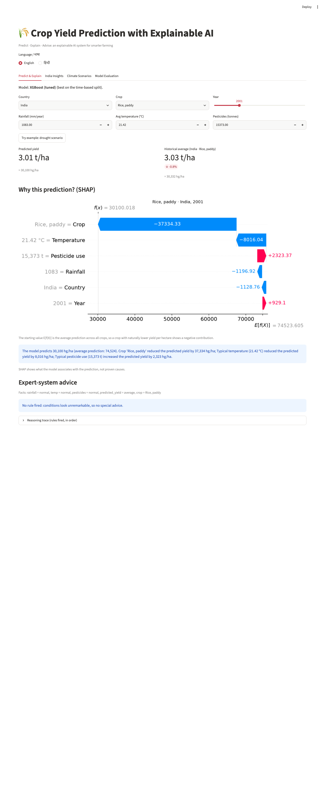
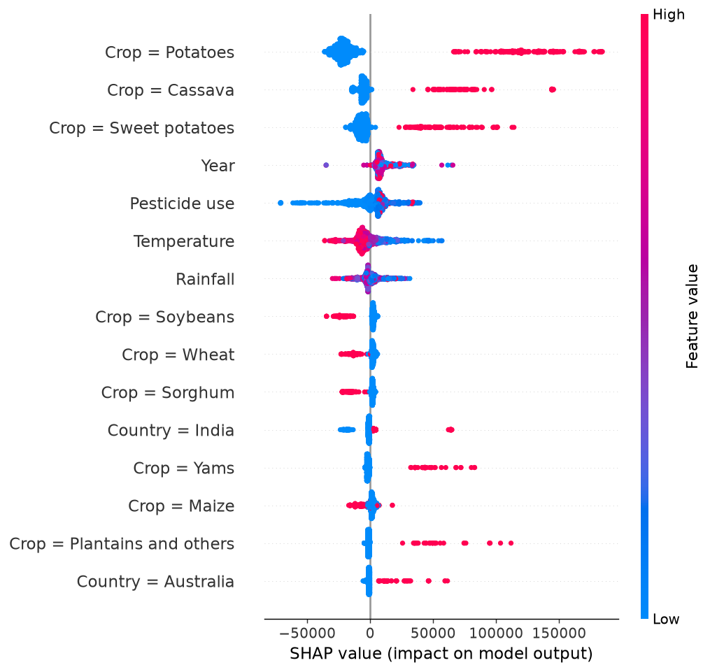

# 🌾 Crop Yield Prediction with Machine Learning and Explainable AI
### Global and India Case Study · PAI101 Essentials of Artificial Intelligence

This project combines **four things in one pipeline**:

1. **Prediction** – five ML models (Linear Regression, Decision Tree, Random Forest, XGBoost, MLP neural network) predict crop yield from crop, country/state, year, rainfall, temperature and pesticide/fertilizer use.
2. **Explainability (SHAP)** – every prediction is explained with SHAP waterfall plots and a plain-English sentence.
3. **A rule-based expert system** – 16 IF-THEN rules (forward + backward chaining) turn a prediction into farmer advice, with a visible reasoning trace.
4. **An India case study** – state-level data (1997-2020), India-specific rules (Kharif monsoon deficit, Krishi Vigyan Kendra, Soil Health Card, PMFBY) and an India-vs-world comparison.

A Streamlit app ties it together. A central methodological point: we evaluate with both a **random split** and a **time-based split**, and show why the random split is over-optimistic.



## Syllabus mapping

| Syllabus unit | Where it appears |
|---|---|
| Data analysis: descriptive, exploratory, inferential, predictive | `notebooks/01_eda.ipynb` (ANOVA, correlation tests), `notebooks/02_modeling.ipynb` |
| ML essentials + intro to neural networks | `src/train.py` – model comparison incl. `MLPRegressor` |
| Knowledge representation (rule-based systems, forward/backward chaining) | `src/advisor.py`, `tests/test_advisor.py` |
| Recent advancements: XAI, AI for Social Good (climate, sustainability, food security) | `src/explain.py`, `notebooks/03_xai.ipynb`, `REPORT.md` |
| Case study: Smart Agriculture | `app.py` (Streamlit), `notebooks/04_india.ipynb` |

## Datasets (in `data/`, both well below 25 MB so committed)

| File | Source |
|---|---|
| `yield_df.csv` – global, 101 countries, 10 crops, 1990-2013 (FAO + World Bank) | Kaggle "Crop Yield Prediction Dataset" – https://www.kaggle.com/datasets/patelris/crop-yield-prediction-dataset |
| `india_crop_production.csv` – 30 Indian states, 55 crops, 1997-2020 | Kaggle "Agricultural Crop Yield in Indian States Dataset" – https://www.kaggle.com/datasets/akshatgupta7/crop-yield-in-indian-states-dataset |

If you ever need to re-download them, put the two CSVs in `data/` with exactly these names.

## Setup

```bash
python3 -m venv .venv && source .venv/bin/activate
pip install -r requirements.txt
# macOS only: XGBoost needs the OpenMP runtime
brew install libomp
```

## How to run

```bash
python -m src.train          # global models: comparison, tuning, saves models/best_model.joblib (~6 min)
python -m src.india          # India models: saves models/india_model.joblib (~5 min)
python -m pytest -q          # expert-system unit tests
streamlit run app.py         # interactive demo
# execute notebooks (outputs are saved in the .ipynb files)
cd notebooks && jupyter nbconvert --to notebook --execute --inplace 01_eda.ipynb 02_modeling.ipynb 03_xai.ipynb 04_india.ipynb
```
Run notebooks in order after `src.train` and `src.india`; they read the saved results/models. Notebook kernel name is `cropxai` (`python -m ipykernel install --user --name cropxai`).

## Project structure

```
data/                 two CSVs
src/config.py         ALL paths and column names (both datasets)
src/data.py           global cleaning, random + time splits
src/features.py      ColumnTransformer/Pipeline (reusable for both datasets)
src/train.py          5 models x 2 splits, CV, RandomizedSearchCV, saves best model
src/evaluate.py       metrics, forward-chaining CV, diagnostic plots
src/explain.py        SHAP explainer (one-hot -> readable), sentences
src/explain_global.py all global XAI figures
src/india.py          India cleaning, modelling, SHAP, India-vs-world
src/advisor.py        rule-based expert system
notebooks/            01_eda, 02_modeling, 03_xai, 04_india (executed)
app.py                Streamlit app (3 tabs)
tests/test_advisor.py pytest
models/               best_model.joblib, india_model.joblib (+ metadata)
outputs/figures|results   all plots and CSV tables
REPORT.md             draft academic report
```

## Results summary (all numbers produced by the code)

**Global (hg/ha).** Time-based split = train 1990-2009, test 2010-2013.

| Model | Random R² | Random RMSE | Time R² | Time RMSE |
|---|---|---|---|---|
| Linear Regression | 0.776 | 40,250 | 0.709 | 51,350 |
| Decision Tree | 0.976 | 13,120 | 0.936 | 24,045 |
| Random Forest | **0.984** | **10,672** | 0.955 | 20,306 |
| XGBoost | 0.974 | 13,756 | 0.951 | 21,170 |
| MLP (neural net) | 0.961 | 16,822 | 0.934 | 24,544 |
| **XGBoost (tuned)** | – | – | **0.957** | **19,671** |

Best global model (chosen on time-split CV R²): **tuned XGBoost** – time split R² 0.957, MAE 10,371 hg/ha (≈1.04 t/ha).
**Key finding:** every model scores higher on the random split because 71 % of random test rows have the same country-crop series in training in *both* the previous and next year (0 % in the time split); a trivial "mean of this country-crop pair" lookup already scores R² 0.94 on the random split. The time-based split is the honest estimate.

**India (t/ha).** Train 1997-2016, test 2017-2020; Coconut (measured in nuts) excluded.

| Model | Random R² | Random RMSE | Time R² | Time RMSE |
|---|---|---|---|---|
| Random Forest | 0.967 | 2.13 | 0.917 | 3.65 |
| XGBoost | 0.971 | 1.98 | 0.902 | 3.98 |
| **XGBoost (tuned)** | 0.971 | 1.99 | **0.927** | **3.44** |

Best India model: **tuned XGBoost** (time-split R² 0.927, MAE 1.08 t/ha).

**Explainability.** Global SHAP share of total importance: Crop 58.7 %, Year 9.7 %, Country 9.7 %, Pesticide 9.0 %, Temperature 8.1 %, Rainfall 4.8 % (the model's built-in importance would wrongly credit Country with 77 %).

### Key plots
| | |
|---|---|
|  |  |
|  |  |
|  |  |

## Notes and honest limitations
* Models learn **associations**, not causes; SHAP explains the model, not the farm.
* Rainfall/temperature are annual country-level (global) or state-level (India) values.
* The saved models are trained on the training part of the time split (so reported metrics describe exactly the saved model).
* The expert-system rules are illustrative agronomy heuristics, not certified advice; consult local extension services.
