# 🌾 Crop Yield Prediction with Machine Learning and Explainable AI
### Global and India Case Study · PAI101 Essentials of Artificial Intelligence

This project combines **four things in one pipeline**:

1. **Prediction** – five ML models (Linear Regression, Decision Tree, Random Forest, XGBoost, MLP neural network) predict crop yield from crop, country/state, year, rainfall, temperature and pesticide/fertilizer use.
2. **Explainability (SHAP)** – every prediction is explained with SHAP waterfall plots and a plain-English sentence.
3. **A rule-based expert system** – 16 IF-THEN rules (forward + backward chaining) turn a prediction into farmer advice, with a visible reasoning trace.
4. **An India case study** – state-level data (1997-2020), India-specific rules (Kharif monsoon deficit, Krishi Vigyan Kendra, Soil Health Card, PMFBY) and an India-vs-world comparison.

A Streamlit app ties it together. A central methodological point: we evaluate with both a **random split** and a **time-based split**, and show why the random split is over-optimistic.


## Syllabus mapping

| Syllabus unit | Where it appears |
|---|---|
| Data analysis: descriptive, exploratory, inferential, predictive | `notebooks/01_eda.ipynb` (ANOVA, correlation tests), `notebooks/02_modeling.ipynb` |
| ML essentials + intro to neural networks | `src/train.py` – model comparison incl. `MLPRegressor` |
| Knowledge representation (rule-based systems, forward/backward chaining) | `src/advisor.py`, `tests/test_advisor.py` |
| Recent advancements: XAI, AI for Social Good (climate, sustainability, food security) | `src/explain.py`, `notebooks/03_xai.ipynb`, `REPORT.md` |
| Case study: Smart Agriculture | `app.py` (Streamlit), `notebooks/04_india.ipynb` |

## Datasets (in `data/`, both well below 25 MB so committed)

| File | Source |
|---|---|
| `yield_df.csv` – global, 101 countries, 10 crops, 1990-2013 (FAO + World Bank) | Kaggle "Crop Yield Prediction Dataset" – https://www.kaggle.com/datasets/patelris/crop-yield-prediction-dataset |
| `india_crop_production.csv` – 30 Indian states, 55 crops, 1997-2020 | Kaggle "Agricultural Crop Yield in Indian States Dataset" – https://www.kaggle.com/datasets/akshatgupta7/crop-yield-in-indian-states-dataset |

If you ever need to re-download them, put the two CSVs in `data/` with exactly these names.

## Setup

```bash
python3 -m venv .venv && source .venv/bin/activate
pip install -r requirements.txt
# macOS only: XGBoost needs the OpenMP runtime
brew install libomp
```

## How to run

```bash
python -m src.scenarios      # scan all climate-scenario combinations (defaults of the Climate Scenarios tab)
python -m src.train          # global models: comparison, tuning, saves models/best_model.joblib (~6 min)
python -m src.india          # India models: saves models/india_model.joblib (~5 min)
python -m pytest -q          # 29 tests: expert system, scenarios/recommender, translations, end-to-end app (English + Hindi)
streamlit run app.py         # interactive demo
# execute notebooks (outputs are saved in the .ipynb files)
cd notebooks && jupyter nbconvert --to notebook --execute --inplace 01_eda.ipynb 02_modeling.ipynb 03_xai.ipynb 04_india.ipynb
```
Run notebooks in order after `src.train` and `src.india`; they read the saved results/models. Notebook kernel name is `cropxai` (`python -m ipykernel install --user --name cropxai`).

## Project structure

```
data/                 two CSVs
src/config.py         ALL paths and column names (both datasets)
src/data.py           global cleaning, random + time splits
src/features.py      ColumnTransformer/Pipeline (reusable for both datasets)
src/train.py          5 models x 2 splits, CV, RandomizedSearchCV, saves best model
src/evaluate.py       metrics, forward-chaining CV, diagnostic plots
src/explain.py        SHAP explainer (one-hot -> readable), sentences
src/explain_global.py all global XAI figures
src/india.py          India cleaning, modelling, SHAP, India-vs-world
src/advisor.py        rule-based expert system (English + Hindi rule texts)
src/i18n.py           the single English / Hindi translation dictionary (+ Devanagari font lookup)
src/charts.py         language-aware charts drawn live by the app
src/scenarios.py      climate what-if scenarios + crop recommender logic
notebooks/            01_eda, 02_modeling, 03_xai, 04_india (executed)
app.py                Streamlit app (3 tabs)
tests/                pytest (test_advisor.py, test_scenarios.py, test_app.py)
models/               best_model.joblib, india_model.joblib (+ metadata)
outputs/figures|results   all plots and CSV tables
REPORT.md             draft academic report
```

## Results summary (all numbers produced by the code, 3 decimals)

**Global (hg/ha).** Time-based split = train 1990-2009, test 2010-2013. Random Forest and XGBoost are tuned on both splits.

*Random 80/20 split*

| Model                |   CV R² |   Test R² |       MAE |      RMSE |   Train time (s) |
|:---------------------|--------:|----------:|----------:|----------:|-----------------:|
| LinearRegression     |   0.770 |     0.776 | 22682.090 | 40250.010 |            0.045 |
| DecisionTree         |   0.976 |     0.976 |  4199.062 | 13120.316 |            0.082 |
| RandomForest         |   0.985 |     0.984 |  4013.476 | 10672.207 |            1.446 |
| XGBoost              |   0.974 |     0.974 |  7836.832 | 13755.629 |            0.617 |
| MLP                  |   0.954 |     0.961 |  8671.715 | 16822.028 |            8.603 |
| RandomForest (tuned) |   0.984 |     0.983 |  4657.917 | 11202.755 |            0.996 |
| XGBoost (tuned)      |   0.986 |     0.986 |  4414.397 | 10236.611 |            1.547 |

*Time-based split*

| Model                |   CV R² |   Test R² |       MAE |      RMSE |   Train time (s) |
|:---------------------|--------:|----------:|----------:|----------:|-----------------:|
| LinearRegression     |   0.767 |     0.709 | 28689.371 | 51349.722 |            0.038 |
| DecisionTree         |   0.935 |     0.936 | 11518.027 | 24044.682 |            0.082 |
| RandomForest         |   0.957 |     0.955 | 10409.940 | 20306.313 |            1.411 |
| XGBoost              |   0.955 |     0.951 | 12286.857 | 21170.246 |            0.602 |
| MLP                  |   0.903 |     0.934 | 14157.890 | 24544.244 |            8.766 |
| RandomForest (tuned) |   0.955 |     0.953 | 10838.375 | 20743.712 |            1.007 |
| XGBoost (tuned)      |   0.960 |     0.957 | 10370.513 | 19671.442 |            1.629 |

Best global model (chosen on time-split CV R²): **tuned XGBoost** – time-split R² 0.957, MAE 10370.513 hg/ha (≈1.04 t/ha), RMSE 19671.442.
**Key finding:** every model scores higher on the random split because 71 % of random test rows have the same country-crop series in training in *both* the previous and next year (0 % in the time split); a trivial "mean of this country-crop pair" lookup already scores R² 0.94 on the random split. The time-based split is the honest estimate.

**India (t/ha).** Train 1997-2016, test 2017-2020; Coconut (measured in nuts) excluded; Fertilizer and Pesticide used **per hectare**.

*Random split*

| Model                |   CV R² |   Test R² |   MAE |   RMSE |   Train time (s) |
|:---------------------|--------:|----------:|------:|-------:|-----------------:|
| RandomForest         |   0.955 |     0.970 | 0.594 |  2.026 |            2.349 |
| XGBoost              |   0.954 |     0.969 | 0.720 |  2.060 |            0.572 |
| RandomForest (tuned) |   0.954 |     0.969 | 0.756 |  2.057 |            1.034 |
| XGBoost (tuned)      |   0.956 |     0.970 | 0.656 |  2.031 |            1.561 |

*Time-based split*

| Model                |   CV R² |   Test R² |   MAE |   RMSE |   Train time (s) |
|:---------------------|--------:|----------:|------:|-------:|-----------------:|
| RandomForest         |   0.929 |     0.913 | 0.899 |  3.737 |            2.313 |
| XGBoost              |   0.933 |     0.903 | 1.010 |  3.957 |            0.569 |
| RandomForest (tuned) |   0.928 |     0.910 | 1.053 |  3.799 |            1.087 |
| XGBoost (tuned)      |   0.936 |     0.920 | 1.090 |  3.596 |            0.618 |

Best India model: **tuned XGBoost** (time-split R² 0.920, MAE 1.090 t/ha, RMSE 3.596).

**Explainability.** Global SHAP share of total importance: Crop 58.7 %, Year 9.7 %, Country 9.7 %, Pesticide 9.0 %, Temperature 8.1 %, Rainfall 4.8 % (the model's built-in importance would wrongly credit Country with 77 %). India: Crop 64.0 %, State 12.9 %, Area 9.9 %, Year 4.7 %, Season 4.0 %, Rainfall 3.0 %, Fertilizer/ha 0.8 %, Pesticide/ha 0.6 %.

**App.** Each prediction tab has a "Try example: drought scenario" button (low rainfall, high temperature) so the expert-system rules fire; each SHAP waterfall has a note explaining that the starting value E[f(X)] is the average across all crops.

## Decision support features (in the Streamlit app)

Beyond a single prediction, the app offers three decision-support tools. All of them query the trained models, so they show what the model **associates** with the inputs, not guaranteed forecasts.

| Feature | What it does |
|---|---|
| **Climate Scenarios** tab | Pick a crop and country (global model) or state (India model). Sliders for temperature change (0 to +3 °C) and rainfall change (−30 % to +30 %). Shows the predicted yield change vs "today" (the model's prediction using the location's last observed years of climate) as a chart across all scenarios, plus the full table. The India dataset has no temperature column, so the India model responds to rainfall only. |
| **Crop Recommender** (in *India Insights*) | Pick state, season and rainfall (area optional). Predicts yield for every crop grown in that state and season, each with its own typical area and fertilizer/pesticide per hectare, shows the top 5 as a ranked bar chart (ranked by predicted t/ha, or by % above the crop's usual yield there), and explains the top crop with SHAP. |
| **Language toggle** (English / हिन्दी) | Translates **all visible app text** into simple Hindi: tab names, headings, input labels, buttons, metric labels, notes, captions, table headers, the expert-system advice and reasoning trace, the SHAP sentence, and the titles/axes/legends of every chart. Crop, country and state names, numbers and units (mm/year, °C, t/ha, hg/ha, kg/ha) stay as in the data. All strings live in one dictionary, `src/i18n.py`. Charts use a Devanagari font (Kohinoor Devanagari, Noto Sans Devanagari or Devanagari Sangam MN, whichever is installed); if none is found the chart labels fall back to English instead of showing boxes. |

**Scenario defaults.** `python -m src.scenarios` scans every country-crop pair of the global model (584) and every state-crop-season of the India model (958) and saves the results to `outputs/results/scenario_scan_*.csv`. A combination *qualifies* if the predicted yield falls by at least 5 % with 30 % less rainfall **and** with +3 °C (87 of 584 global combinations do); qualifying ones are ranked by a smoothness score (wrong-direction steps plus roughness). The tab opens on the best one, **Tajikistan · Maize** (−8.7 % with 30 % less rain, −7.9 % at +3 °C). The next three are Greece · Rice, paddy (−14.5 % / −16.4 %), Armenia · Maize (−7.5 % / −9.0 %) and Malawi · Cassava (−6.5 % / −15.4 %). **No India combination qualifies** under the global model (its closest, cassava, falls only 1.8 % / 0.6 %). The India model has no temperature input, so it can only be judged on rainfall (182 of 958 pass); in India-model mode the tab opens on its smoothest one, **Punjab · Groundnut (Kharif)** (−9.9 % at 30 % less rain, essentially a straight line). Selecting the best of hundreds of combinations is a presentation choice, not evidence: when I re-ran the top picks with other baselines, Tajikistan · Maize dropped to a 1.6 % heat effect with an older baseline, whereas Armenia · Maize and Malawi · Cassava stayed above 5 % in all four variants tried.

**Recommender defaults.** By default every crop is predicted with **its own** typical conditions in the selected state and season: its median area and its median fertilizer and pesticide per hectare (checkbox "Use each crop's typical area", on by default; the Area box is an optional override applied to all crops, with a caption showing the typical range). For Punjab in Kharif at the default 512.6 mm, Rice is predicted at 4.24 t/ha against a usual 3.81 (+11.3 %; the actual 2019 yield was 4.03), where one shared 8,000 ha had given 2.49 (−34.6 %). Top 5: Rice 4.24, Maize 3.65, Cotton (lint) 3.28, Groundnut 1.40, Bajra 1.25 t/ha. Some small crops still land far from their historical mean (e.g. Sesamum +113.6 %), because yields have trended upward and the historical mean includes early years.

Honest caveats (also shown in the app): the models learned patterns across many countries/states and years, so scenario curves can look counter-intuitive (e.g. for India wheat, a non-default crop, the global model predicts +17.0 % at −30 % rainfall and −13.2 % at +3 °C with unchanged rainfall); tree models change in steps; in the India data *Area* is the total area under a crop in a whole state, so single-farm sizes are out of range; yields in t/ha are not comparable across crops in value or effort, and the recommender ignores prices, soil, water and rotation.

| Climate Scenarios | Crop Recommender | Model Evaluation |
|---|---|---|
| 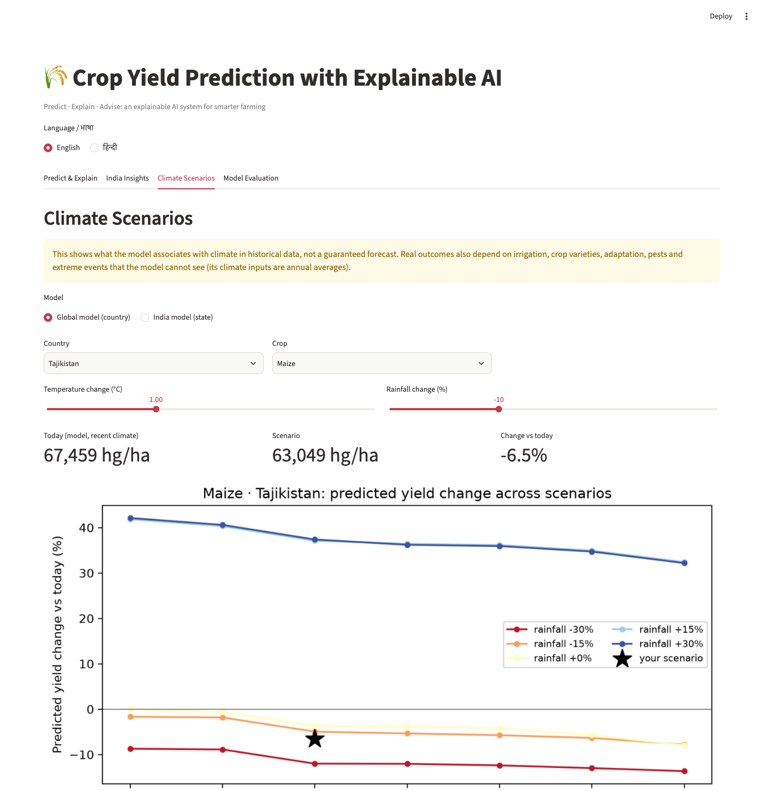 | 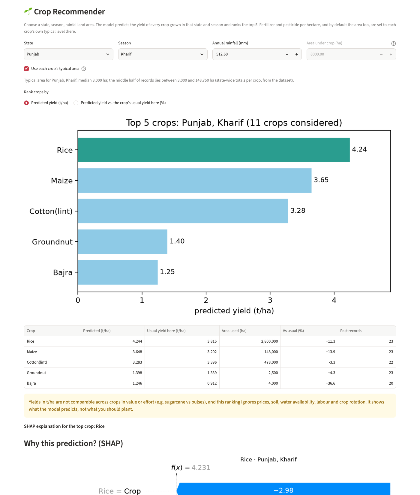 | 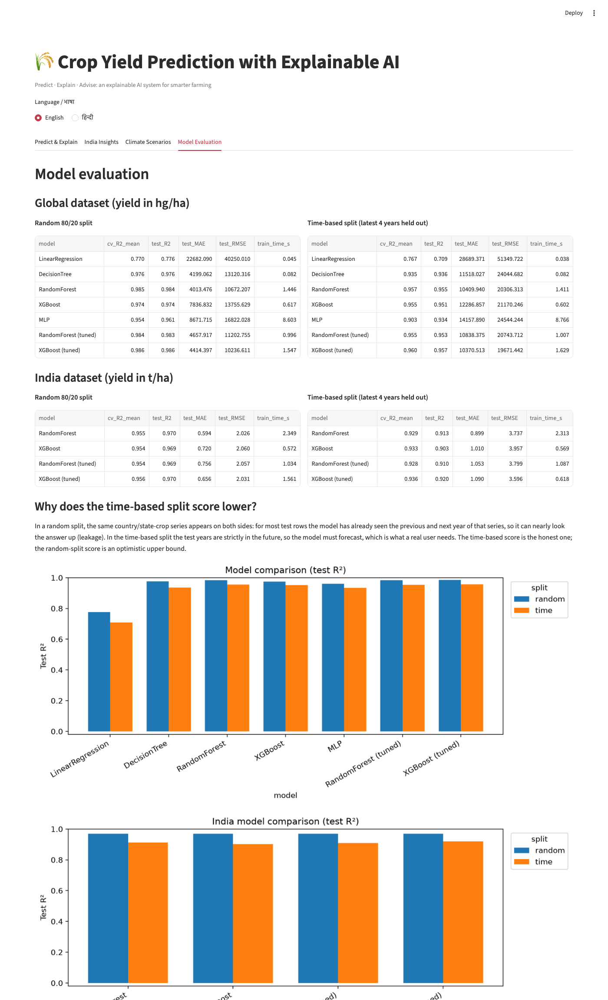 |
| 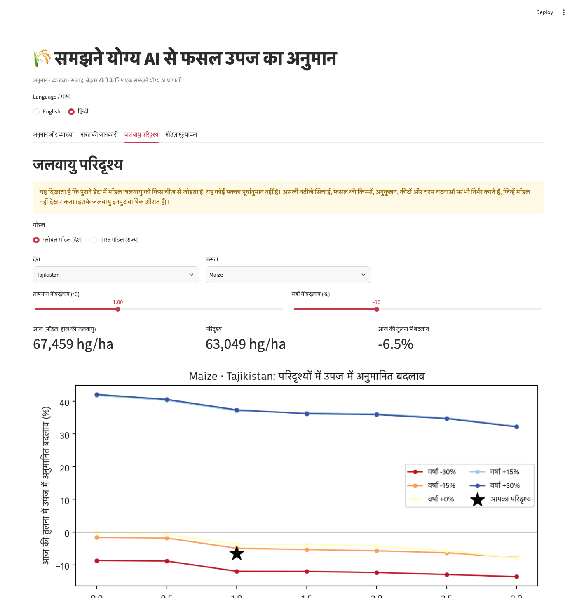 | 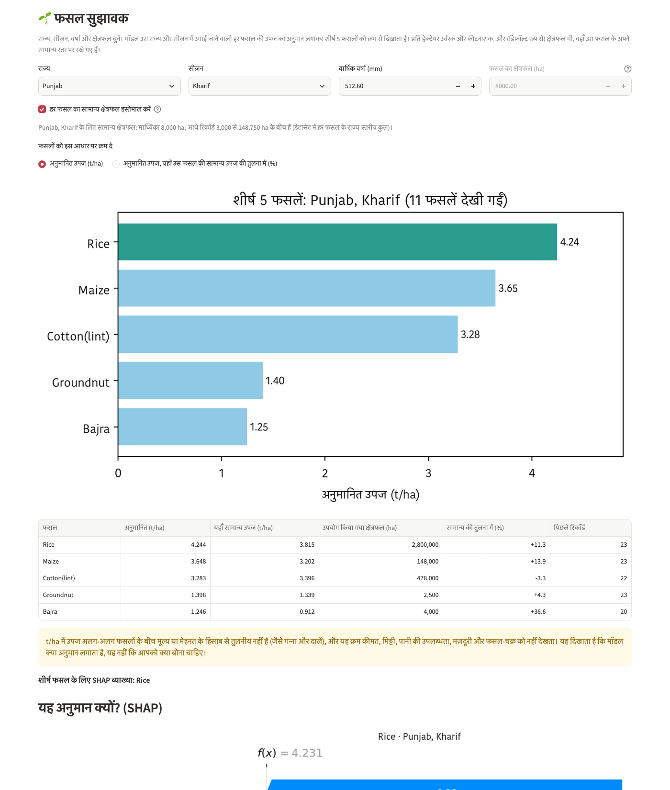 | 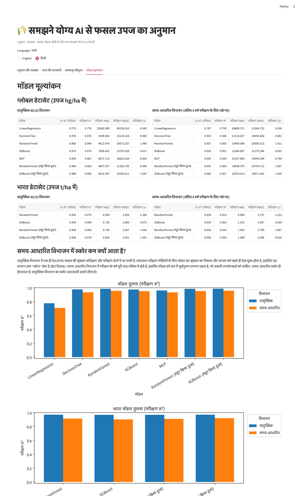 |
| 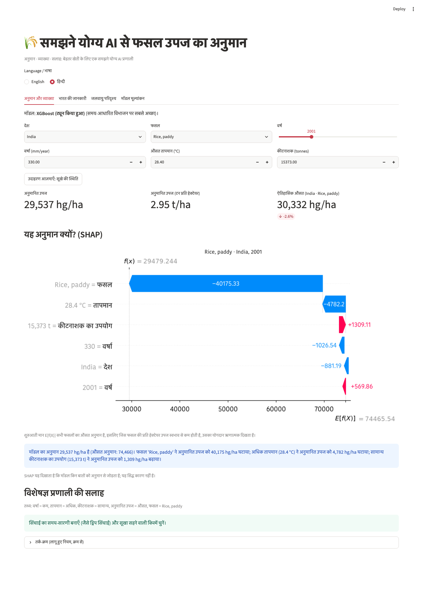 | 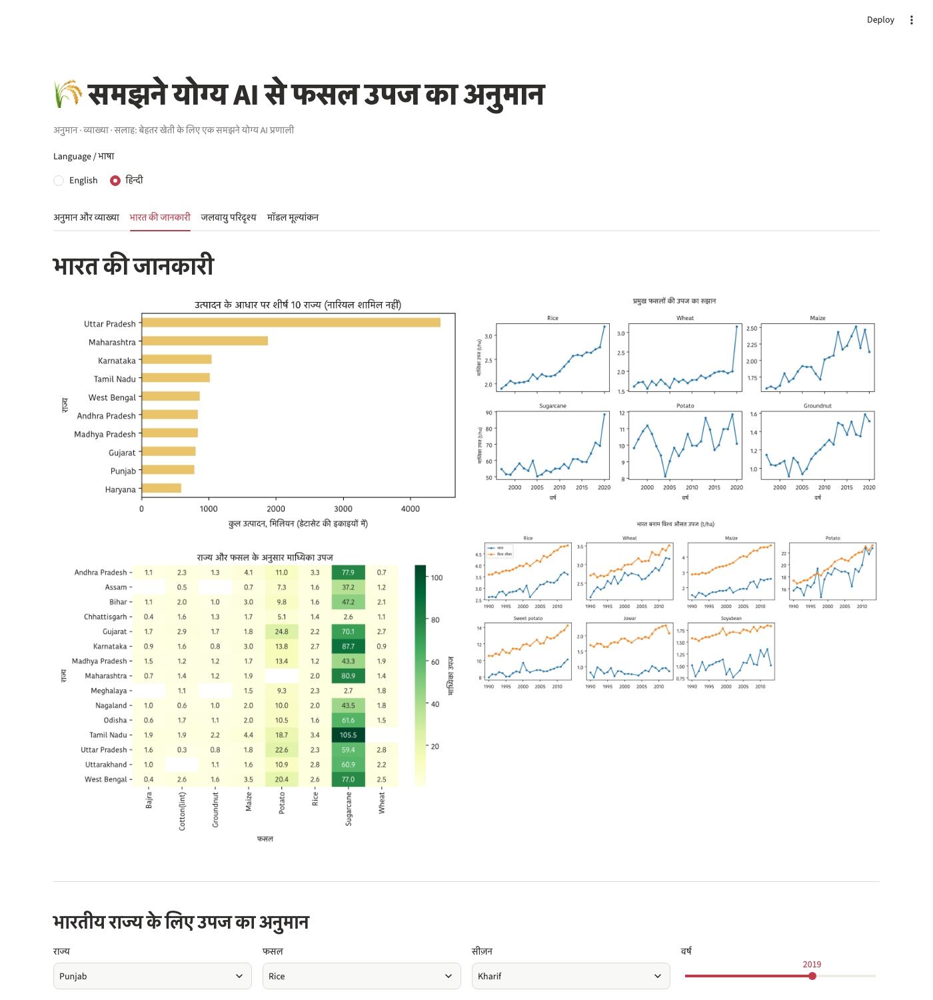 | |

### Key plots
| | |
|---|---|
| 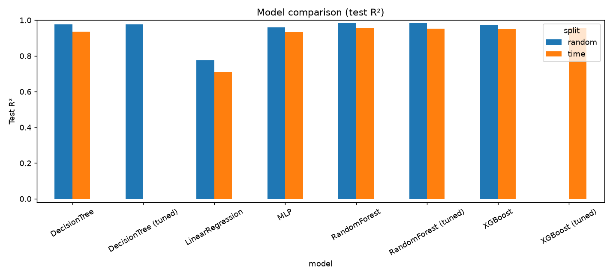 |  |
| 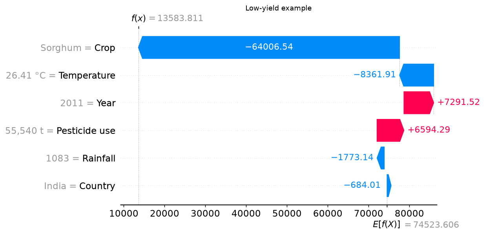 | 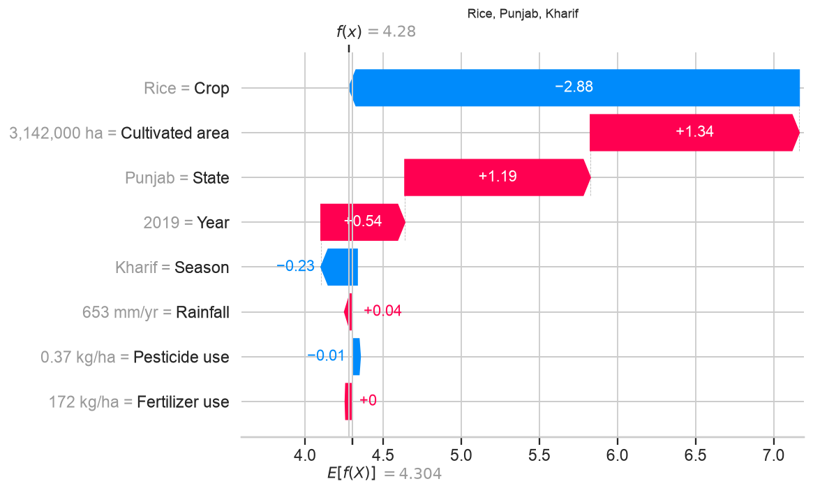 |
| 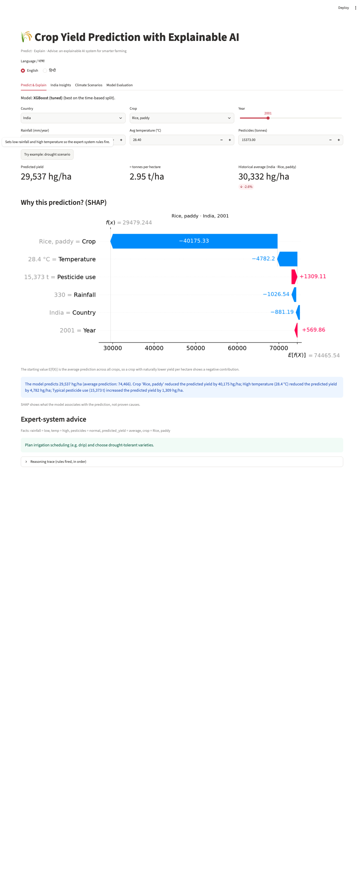 | 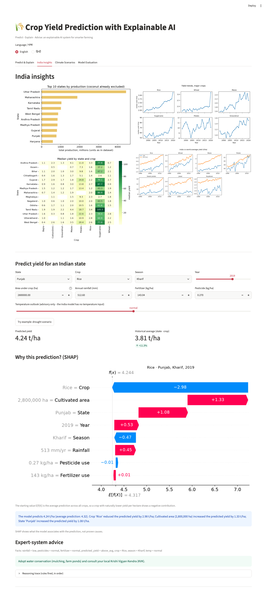 |
|  | 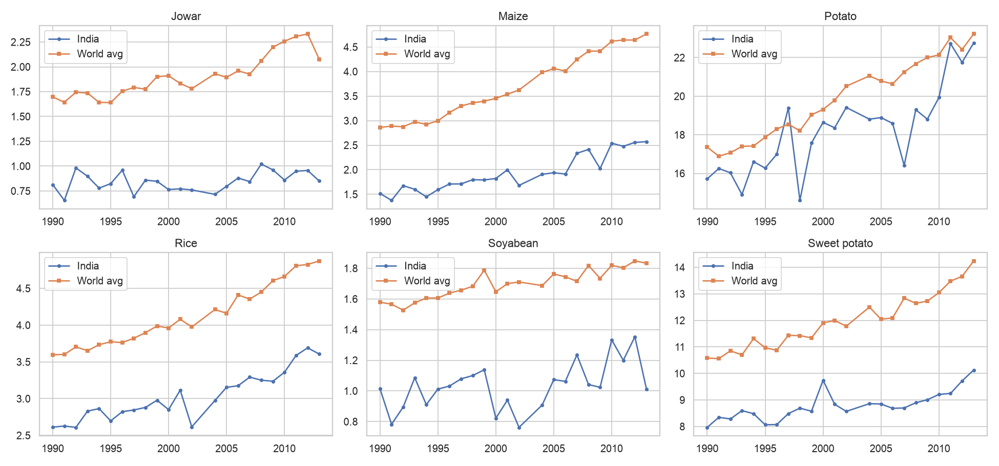 |

## Notes and honest limitations
* Models learn **associations**, not causes; SHAP explains the model, not the farm.
* Rainfall/temperature are annual country-level (global) or state-level (India) values.
* The saved models are trained on the training part of the time split (so reported metrics describe exactly the saved model).
* Scenario and recommender outputs are model associations, not agronomic advice (see *Decision support features*).
* The expert-system rules are illustrative agronomy heuristics, not certified advice; consult local extension services.
