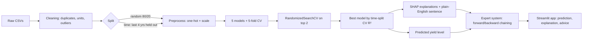

# Crop Yield Prediction using Machine Learning and Explainable AI: A Global and India Case Study

*PAI101 – Essentials of Artificial Intelligence (draft report). All numbers below are produced by the code in this repository (`outputs/results/*.csv`, notebooks 01-04).*

## 1. Abstract
Reliable crop-yield forecasts support food security and climate adaptation, but accurate models are often opaque and their scores are often inflated by careless evaluation. We predict yield on two datasets – a global FAO/World Bank panel (101 countries, 10 crops, 1990-2013, 25,932 rows after cleaning) and an Indian state-level dataset (1997-2020, 19,196 rows) – using Linear Regression, Decision Tree, Random Forest, XGBoost and a feed-forward neural network (MLP). Models are evaluated under a random 80/20 split and a time-based split (latest four years held out). Random splits give R² up to 0.984 on the global data, but the honest time-based score is 0.957 for the best model (tuned XGBoost, RMSE 19,671.442 hg/ha), because country-crop series leak across a random split. We explain predictions with SHAP (crop type contributes 58.7 % of total absolute SHAP importance), convert predictions to plain-English sentences, and feed them into a 16-rule expert system with forward and backward chaining that produces farmer advice with a reasoning trace. An India-specific model (tuned XGBoost, time-split R² 0.920) and an India-vs-world comparison complete the case study, which is delivered as a Streamlit application.

## 2. Introduction and motivation
Agriculture feeds the world and employs a large share of the population in developing countries, yet it is exposed to climate variability: changing rainfall and temperature directly affect yields. Early, understandable yield forecasts help governments plan imports and stocks, and help farmers decide on irrigation, inputs and insurance – contributing to the UN Sustainable Development Goals on zero hunger and climate action, a typical **AI for Social Good** application. India is a particularly relevant setting: millions of smallholders depend on a monsoon that is increasingly erratic.

Two obstacles limit practical use of ML here. (1) *Trust*: a farmer or extension officer will not act on a black-box number. (2) *Honest evaluation*: yield data are time series per place, and naive random splitting overstates how well a model forecasts the future. This project addresses both: explanations through SHAP and an expert system, and a deliberate comparison of two evaluation protocols.

## 3. Background
**ML in agriculture.** Tree ensembles such as Random Forests (Breiman, 2001) and gradient boosting (XGBoost; Chen & Guestrin, 2016) are strong baselines on tabular agronomic data, as they capture non-linear effects and interactions (e.g. a temperature effect that depends on the crop). Neural networks (here an MLP) can fit the same data but need scaling and more tuning.

**Explainable AI.** SHAP (Lundberg & Lee, 2017) assigns each feature a Shapley value so that prediction = base value + sum of contributions. For tree models `TreeExplainer` computes them exactly and efficiently. SHAP is local (one prediction) and, when aggregated, global.

**Expert systems.** Rule-based systems (e.g. MYCIN; Buchanan & Shortliffe, 1984) represent expert knowledge as IF-THEN rules over facts. *Forward chaining* is data-driven: fire rules whose conditions hold until nothing new is derived. *Backward chaining* is goal-driven: prove a goal by recursively proving the conditions of rules that conclude it. Their strength is transparency – every conclusion has a trace.

## 4. Datasets
**Global** (`yield_df.csv`; Kaggle compilation of FAO crop data and World Bank climate/pesticide data; https://www.kaggle.com/datasets/patelris/crop-yield-prediction-dataset). Columns: country, crop, year, yield (hg/ha), annual rainfall (mm), pesticides (tonnes), average temperature (°C). Raw 28,242 rows; no missing values; **2,310 exact duplicates removed** → 25,932 rows; 101 countries, 10 crops, 1990-2013. 7.4 % of yields are IQR outliers (> 230,426 hg/ha) but are genuine root-crop yields (potatoes, cassava, sweet potatoes), so they were **kept**. Rainfall and temperature are country-year values shared by all crops.

**India** (`india_crop_production.csv`; Kaggle "Agricultural Crop Yield in Indian States"; https://www.kaggle.com/datasets/akshatgupta7/crop-yield-in-indian-states-dataset). Columns: crop, year, season, state, area, production, annual rainfall, fertilizer, pesticide, yield. Raw 19,689 rows (30 states, 55 crops). Cleaning: whitespace stripped (season values had trailing spaces); 112 rows with zero Production removed; **165 Coconut rows excluded** because coconut is recorded in number of nuts, not tonnes (yields in the thousands that dominate squared-error metrics and the SHAP base value); yield **recomputed as Production/Area** because the shipped `Yield` differs from it (median absolute difference 0.057, 79 % of rows differ by more than 1 %; cause undocumented); 216 extreme yields removed with a per-crop Tukey fence (Q1 − 3·IQR, Q3 + 3·IQR). Final 19,196 rows. `Production` is never used as a feature because yield = Production/Area (target leakage). Fertilizer and pesticide are totals for the whole cultivated area, so they are converted to **per-hectare intensities** (total ÷ Area) and used as features in place of the totals. The 2020 year has only 37 rows.

## 5. Methodology

*Preprocessing* (`src/features.py`): a `ColumnTransformer` one-hot encodes categoricals (`handle_unknown="ignore"`) and standardises numerics, inside a `Pipeline` with the model so no information leaks from test data. A log1p target was tested per model on training-year CV only (never on test): it helped Linear Regression (CV R² 0.745 → 0.761) but not the tree models or MLP, so it is used only for Linear Regression; metrics are always in original units.
*Cross-validation*: 5-fold shuffled KFold for the random split; 5-fold forward-chaining by year for the time split (a fold never trains on the future).
*Tuning*: `RandomizedSearchCV`, 20 iterations, on Random Forest and XGBoost (the two strongest families by CV R²) on **both** splits, so every tuned model can be compared across splits. `random_state=42` throughout.
*Model selection*: highest time-split CV R², then reported on the test set.
*India*: the same pipeline on the two best model types from the global study (Random Forest and XGBoost).

## 6. Results
### 6.1 Global (yield in hg/ha; every number rounded to 3 decimals)
Random Forest and XGBoost were tuned (`RandomizedSearchCV`, 20 iterations) on **both** splits, so each model has a random-split and a time-split result (`outputs/figures/model_comparison.png`).

**Random 80/20 split**

| Model                |   CV R² |   Test R² |       MAE |      RMSE |   Train time (s) |
|:---------------------|--------:|----------:|----------:|----------:|-----------------:|
| LinearRegression     |   0.770 |     0.776 | 22682.090 | 40250.010 |            0.045 |
| DecisionTree         |   0.976 |     0.976 |  4199.062 | 13120.316 |            0.082 |
| RandomForest         |   0.985 |     0.984 |  4013.476 | 10672.207 |            1.446 |
| XGBoost              |   0.974 |     0.974 |  7836.832 | 13755.629 |            0.617 |
| MLP                  |   0.954 |     0.961 |  8671.715 | 16822.028 |            8.603 |
| RandomForest (tuned) |   0.984 |     0.983 |  4657.917 | 11202.755 |            0.996 |
| XGBoost (tuned)      |   0.986 |     0.986 |  4414.397 | 10236.611 |            1.547 |

**Time-based split (train 1990-2009, test 2010-2013)**

| Model                |   CV R² |   Test R² |       MAE |      RMSE |   Train time (s) |
|:---------------------|--------:|----------:|----------:|----------:|-----------------:|
| LinearRegression     |   0.767 |     0.709 | 28689.371 | 51349.722 |            0.038 |
| DecisionTree         |   0.935 |     0.936 | 11518.027 | 24044.682 |            0.082 |
| RandomForest         |   0.957 |     0.955 | 10409.940 | 20306.313 |            1.411 |
| XGBoost              |   0.955 |     0.951 | 12286.857 | 21170.246 |            0.602 |
| MLP                  |   0.903 |     0.934 | 14157.890 | 24544.244 |            8.766 |
| RandomForest (tuned) |   0.955 |     0.953 | 10838.375 | 20743.712 |            1.007 |
| XGBoost (tuned)      |   0.960 |     0.957 | 10370.513 | 19671.442 |            1.629 |

Best global model: **tuned XGBoost**, selected on time-split CV R² (0.960; test R² 0.957). Its time-split hyper-parameters: 643 trees, depth 10, learning rate 0.036, subsample 0.67, colsample 0.92. On the random split the tuned XGBoost also scores highest (R² 0.986), but that is the optimistic number. Differences between the tree models on the time split are small (about 0.002-0.006 R²) and within what another seed or split could change; the choice among RF/XGBoost is not a strong claim, whereas the gap to Linear Regression and the random-vs-time gap are large.

### 6.2 KEY FINDING – random split vs time-based split
All models score lower on the time split: Random Forest R² 0.984 → 0.955 and RMSE 10,672 → 20,306 hg/ha (almost doubled); Decision Tree 0.976 → 0.936; MLP 0.961 → 0.934. The reason is **leakage across the split**. Yield of a country-crop pair is highly persistent (e.g. potatoes in the UK are high every year). With random splitting:
* 100 % of test rows have the same country-crop pair in training, and **71.1 %** have it in training in *both* year−1 and year+1, so the model can interpolate between neighbours;
* a trivial lookup – "predict the training mean of this country-crop pair", no weather at all – already reaches **R² 0.939** (RMSE 21,060).

In the time-based split, test years are strictly later: 0.0 % of test rows are sandwiched between known years, only 24.8 % even have the previous year in training, and the lookup baseline drops to R² 0.889 (RMSE 31,709). The time split mimics real forecasting and is therefore the honest estimate; we select models on it and treat random-split scores as optimistic upper bounds. (The models still beat the pair-mean lookup on the time split – 0.957 vs 0.889 – so they learn more than memorisation, but the margin is far smaller than random-split scores suggest.)

### 6.3 India (yield in t/ha; train 1997-2016, test 2017-2020)
Features: Crop, Season, State, Year, Area, Rainfall and **Fertilizer and Pesticide per hectare** (totals divided by Area; totals mostly encode farm size). Random Forest and XGBoost (the two best global families) were tuned on both splits.

**Random split**

| Model                |   CV R² |   Test R² |   MAE |   RMSE |   Train time (s) |
|:---------------------|--------:|----------:|------:|-------:|-----------------:|
| RandomForest         |   0.955 |     0.970 | 0.594 |  2.026 |            2.349 |
| XGBoost              |   0.954 |     0.969 | 0.720 |  2.060 |            0.572 |
| RandomForest (tuned) |   0.954 |     0.969 | 0.756 |  2.057 |            1.034 |
| XGBoost (tuned)      |   0.956 |     0.970 | 0.656 |  2.031 |            1.561 |

**Time-based split**

| Model                |   CV R² |   Test R² |   MAE |   RMSE |   Train time (s) |
|:---------------------|--------:|----------:|------:|-------:|-----------------:|
| RandomForest         |   0.929 |     0.913 | 0.899 |  3.737 |            2.313 |
| XGBoost              |   0.933 |     0.903 | 1.010 |  3.957 |            0.569 |
| RandomForest (tuned) |   0.928 |     0.910 | 1.053 |  3.799 |            1.087 |
| XGBoost (tuned)      |   0.936 |     0.920 | 1.090 |  3.596 |            0.618 |

The same pattern holds: tuned XGBoost R² 0.970 (random) vs 0.920 (time), RMSE 2.031 → 3.596 t/ha. Best India model: **tuned XGBoost**. Switching from fertilizer/pesticide totals to per-hectare values lowered the time-split R² slightly (0.927 → 0.920 for tuned XGBoost) but makes the features agronomically meaningful and removes a farm-size proxy. (An earlier run that included Coconut showed the *opposite* ordering on R² because a handful of nut-count "yields" dominated the metric – a reminder to check units before trusting any score; Coconut is excluded.) The MLP was evaluated globally but ranked below the tree models, so it was not carried to India.

## 7. Explainability insights
*Global SHAP (best model, 1,500 test rows; share of total mean |SHAP|, one-hot columns summed to their original feature):* Crop 58.7 %, Year 9.7 %, Country 9.7 %, Pesticide use 9.0 %, Temperature 8.1 %, Rainfall 4.8 %.
* **Crop type sets the scale** of the prediction; other features fine-tune it. This is consistent with ANOVA in the EDA (crop explains 60 % of yield variance, η² = 0.60).
* **SHAP vs built-in importance disagree.** XGBoost's built-in importance credits Country with 76.7 % and Year 0.07 %, because it is summed over ~100 country dummy columns and measures split gain on training data; SHAP, measured on held-out predictions, gives Country 9.7 % and Year 9.7 %. We therefore prefer SHAP for explanation.
* **Local examples** (time-split test set): a high-yield case (Yams in Japan, 2010; predicted 212,212 hg/ha) is driven up by crop (+74,721) and country (+35,530); a low case (Sorghum in India, 2011; predicted 13,584) is driven down by crop (−64,007) and high temperature (−8,362) – the plain-English sentence generator reports exactly these top-3 contributions.
* **Caution:** high pesticide totals raise predictions largely because they mark large, intensive agricultural countries; this is association, not evidence that more pesticide causes higher yield. Weather effects are weaker than crop/country effects and interact with them.
* **India SHAP** (500 test rows): Crop 64.0 %, State 12.9 %, Area 9.9 %, Year 4.7 %, Season 4.0 %, Rainfall 3.0 %, Fertilizer per hectare 0.8 %, Pesticide per hectare 0.6 %. With per-hectare inputs the fertilizer and pesticide features carry little importance, whereas as totals they ranked higher (5.1 % and 3.2 % in the earlier run) – evidence that totals were largely proxying farm size and state, not input intensity.

## 8. India case study
* **Statistics:** rice yield differs strongly between seasons (Kruskal-Wallis H = 289.9, p = 1.6×10⁻⁶¹). Within rice, Spearman correlation with rainfall is weak and negative (ρ = −0.13, p = 3.4×10⁻⁶), and positive with fertilizer per hectare (ρ = 0.25) and pesticide per hectare (ρ = 0.24). The weak rainfall link is plausibly due to irrigation and to annual totals missing monsoon timing; the data cannot test this.
* **Trends:** median yield rose over 1997-2020 for rice (+0.043 t/ha per year), wheat (+0.029), maize (+0.037), potato (+0.036), groundnut (+0.024) and sugarcane (+0.83); linear slopes of annual medians.
* **India vs world** (same crops, FAO rows for India, mean over available years, t/ha): Potato 18.2 vs 19.8 (92 % of world average), Wheat 2.65 vs 3.01 (88 %), Rice 3.03 vs 4.13 (73 %), Sweet potato 8.8 vs 12.0 (73 %), Soybean 1.04 vs 1.70 (61 %), Maize 1.93 vs 3.70 (52 %), Sorghum/Jowar 0.85 vs 1.90 (44 %). India is below the world average for all seven crops compared, most for maize and sorghum (rain-fed crops) – consistent with scope for improvement, though comparing a country with a multi-country mean is a coarse benchmark and FAO and state-level sources differ.
* **Worked example:** Rice, Punjab, Kharif, 2019: the India model predicts 4.29 t/ha (actual 4.03 t/ha; average prediction 4.30). Crop "Rice" lowers it by 2.88 t/ha relative to the all-crop average (sugarcane etc. have much higher t/ha), while cultivated area (+1.34) and State Punjab (+1.19) raise it. See `notebooks/04_india.ipynb`.

## 9. Expert system design
`src/advisor.py` stores 16 rules as data (`Rule(name, conditions, conclusions, text)`): general agronomy (drought risk, disease risk, waterlogging, heat stress, favourable conditions) and India-specific rules (Kharif monsoon deficit → water conservation and Krishi Vigyan Kendra; Rabi heat → terminal-heat risk → early sowing; high fertilizer with low yield → Soil Health Card test; drought with low yield → PMFBY insurance). Numeric inputs are discretised into low/normal/high by the 33rd/67th dataset percentiles; the predicted yield becomes `below_avg / average / above_avg` relative to the historical average (±10 %). `forward_chain` repeatedly fires rules until a fixed point and returns derived facts, advice and an ordered trace; `backward_chain(goal)` proves a goal recursively with cycle protection. 10 unit tests pass. The Streamlit app offers a "Try example: drought scenario" button (low rainfall, high temperature) that makes the rules fire, and each SHAP waterfall carries a note explaining that E[f(X)] is the average prediction across all crops.

**Sample reasoning trace** (facts: rainfall low, temp high, predicted_yield below_avg, crop Maize, season Kharif):

| # | Rule | Because | Derived |
|---|---|---|---|
| 1 | R1 | rainfall = low AND temp = high | drought_risk = high |
| 2 | R3 | drought_risk = high | advise_irrigation (irrigation scheduling, drought-tolerant varieties) |
| 3 | R8 | temp = high AND predicted_yield = below_avg | heat_stress = high |
| 4 | R9 | heat_stress = high | advise_sowing_window |
| 5 | R11 | season = Kharif AND rainfall = low | monsoon_deficit = True |
| 6 | R12 | monsoon_deficit = True | advise_water_conservation (consult local KVK) |
| 7 | R16 | drought_risk = high AND predicted_yield = below_avg | advise_insurance (PMFBY) |

Rules 2, 4 and 6 only fire because earlier rules derived intermediate facts – this multi-step inference is what makes it more than a lookup table.

## 10. Limitations and ethics
* **Data bias:** countries/states with better statistical systems are better represented; yields in poorly recorded regions may be noisy. The global panel stops in 2013; India's 2020 has only 37 rows.
* **Correlation vs causation:** SHAP explains the model's behaviour, not the causal effect of an intervention (e.g. more pesticide). Advice must not be read as "increase X to get yield Y".
* **Split leakage:** random-split scores overstate forecast skill (Section 6.2). The time-split test set is only four years; results could differ for other periods, and tuning/selection used the same time series.
* **Resolution:** climate variables are annual, country- or state-level; they miss intra-season timing (monsoon onset, heat waves) that matters most to farmers. India's recomputed yield differs from the shipped column for unknown reasons.
* **Tree models do not extrapolate:** predictions for years/inputs beyond the data are flat or unreliable (the app warns).
* **Expert rules** are simple, illustrative heuristics, not certified agronomy; thresholds come from dataset percentiles, not agronomic norms. Real use needs validation with local extension services and farmers.
* **Responsible use:** the tool is decision *support*; it should not be used to deny credit, insurance or subsidies, and uncertainty must be communicated.

## 11. Conclusion and future work
A gradient-boosted tree model predicts crop yield well (time-split R² 0.957 globally, 0.920 for India), SHAP shows crop and location dominate while weather effects are smaller, and an expert system translates predictions into transparent advice. The honest evaluation shows that random splitting overstates skill. Future work: (i) **satellite data** (NDVI, soil moisture) and sub-national weather for field-level resolution; (ii) **real-time data streams** from weather stations and IoT soil sensors for in-season updates; (iii) **Edge AI** – compress the model to run offline on low-cost devices in villages with poor connectivity, and deliver advice in local languages; (iv) uncertainty estimates (quantile regression/conformal prediction); (v) causal methods and agronomist-validated rules.

## 12. References
1. Breiman, L. (2001). Random Forests. *Machine Learning*, 45, 5-32.
2. Chen, T., & Guestrin, C. (2016). XGBoost: A scalable tree boosting system. *Proc. KDD*.
3. Lundberg, S. M., & Lee, S.-I. (2017). A unified approach to interpreting model predictions. *NeurIPS*.
4. Pedregosa, F. et al. (2011). Scikit-learn: Machine learning in Python. *JMLR*, 12, 2825-2830.
5. Buchanan, B. G., & Shortliffe, E. H. (1984). *Rule-Based Expert Systems: The MYCIN Experiments*. Addison-Wesley.
6. FAO. FAOSTAT crop production statistics. https://www.fao.org/faostat
7. World Bank. Climate Change Knowledge Portal and pesticide data. https://data.worldbank.org
8. Kaggle datasets: Crop Yield Prediction Dataset, https://www.kaggle.com/datasets/patelris/crop-yield-prediction-dataset ; Agricultural Crop Yield in Indian States Dataset, https://www.kaggle.com/datasets/akshatgupta7/crop-yield-in-indian-states-dataset
9. Rolnick, D. et al. (2019). Tackling climate change with machine learning. arXiv:1906.05433.
10. United Nations. Sustainable Development Goals 2 (Zero Hunger) and 13 (Climate Action).
